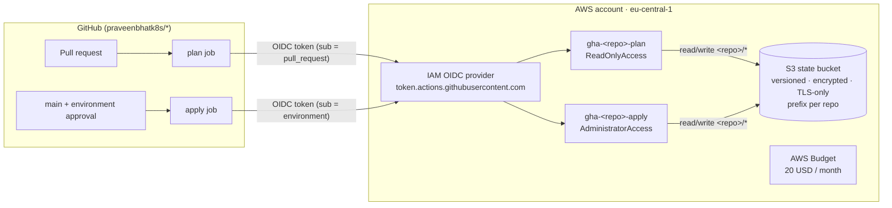

# aws-portfolio-bootstrap


The shared foundation for my AWS-native portfolio projects: one Terraform state bucket, keyless GitHub Actions access via OIDC, per-repo least-privilege state access, and a cost budget. Every other project repo builds on this.

## The problem

I'm building four AWS projects in one personal account. Each one needs remote Terraform state, a way for GitHub Actions to deploy without long-lived access keys, and a guarantee that one repo's pipeline can't overwrite another repo's state. Doing that by hand in each repo means four slightly different, slightly wrong copies. So it lives here, once.

## Architecture



## Design decisions

| Decision | Chosen | Rejected | Why |
| --- | --- | --- | --- |
| State locking | S3 native locking (`use_lockfile = true`) | DynamoDB lock table | Native since Terraform 1.10; one less resource to pay for and secure |
| CI credentials | GitHub OIDC, 1-hour sessions | IAM user access keys in GitHub secrets | Nothing long-lived to leak or rotate |
| Plan vs apply | Two roles per repo | One role per repo | PRs (including from branches) only ever get read-only rights |
| Apply gate | Trust bound to a GitHub *environment* with required reviewers | Trust bound to `refs/heads/main` | A push to main alone can't change infrastructure; a human approves |
| State isolation | One bucket, IAM-scoped prefix per repo | Bucket per repo | Same isolation, one thing to manage |
| Encryption | SSE-S3 | Customer-managed KMS key | State holds no secrets here; a CMK adds cost for no real gain (documented in `.trivyignore`) |
| Apply permissions | `AdministratorAccess` | Hand-written least privilege | Projects create their own IAM roles. Guardrails are the trust policy, the state prefix and the budget. Tightening per project is planned |

## Cost

Effectively 0 USD/month: a few KB of state in S3, and IAM, OIDC and the first two budgets are free.

## Security

- No IAM users and no access keys anywhere. Humans use IAM Identity Center (`aws sso login`); CI uses OIDC.
- The state bucket blocks all public access, enforces bucket-owner object ownership, denies non-TLS requests and keeps 90 days of old versions for rollback.
- `prevent_destroy` on the state bucket.
- This repo itself is applied **locally by a human only**. It creates the roles CI uses, so CI must not be able to change it.

## Usage

Prerequisites: Terraform ≥ 1.10, AWS CLI v2 with an SSO profile called `portfolio`, Trivy (optional).

```bash
aws sso login --profile portfolio
cp terraform.tfvars.example terraform.tfvars   # set budget_email

# 1. First apply uses local state (the bucket doesn't exist yet)
make plan
make apply

# 2. Move this repo's own state into the bucket it just created
#    Uncomment the backend "s3" block in versions.tf, then:
terraform init -migrate-state

# 3. Remove the one-time import block from budget.tf, then confirm no drift
make plan
```

### Wiring a project repo

1. Get the role ARNs: `terraform output plan_role_arns` and `terraform output apply_role_arns`.
2. In the project repo on GitHub: **Settings → Secrets and variables → Actions → Variables**: add `AWS_PLAN_ROLE_ARN` and `AWS_APPLY_ROLE_ARN`.
3. **Settings → Environments → New environment** `aws-portfolio`, with yourself as a required reviewer.
4. Paste `terraform output -raw backend_snippet` into the project's `versions.tf`, with the key set to `<repo>/terraform.tfstate`.

### Adding a new repo

Add its name to `project_repos` in `variables.tf`, then run `make plan` and `make apply`.

## What went wrong

_To be filled in as it happens._

## What I'd do next

- Replace `AdministratorAccess` on apply roles with a permissions boundary that blocks IAM user creation and Organizations changes.
- Add an SCP-style guardrail once there is a member account.
